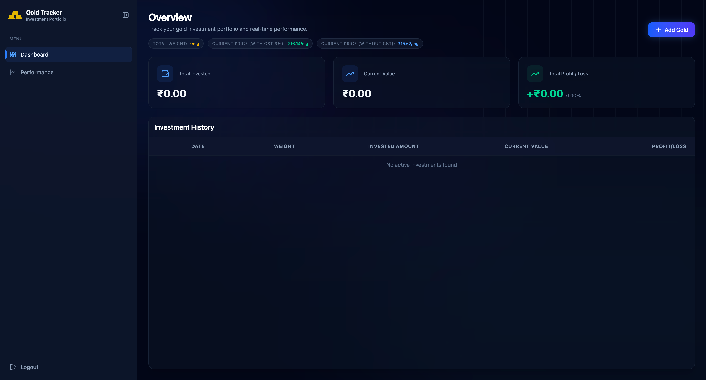
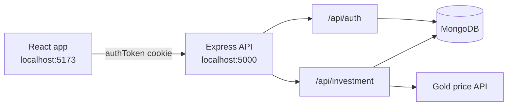

<center>
  <p align="center" style="text-align: center">
    
  </p>
  <h1 align="center" style="text-align: center">Gold Tracker</h1>
  <p align="center" style="text-align: center">
    A full-stack gold portfolio built with React, Vite, and Express — sign in, record a purchase, and follow its value against the live INR price.
  </p>
  <p align="center" style="display: flex; align-items: center; justify-content: center; gap:10px;">
    
    
    
    
    
  </p>

  <h4 align="center" style="text-align: center">
    <a href="https://gold-tracker-kv.vercel.app/" target="_blank" rel="noopener noreferrer">🚀 Live Demo</a>
    <span> · </span>
    <a href="https://github.com/itskaushikverma/Gold-Tracker" target="_blank" rel="noopener noreferrer">📁 Repository</a>
  </h4>
</center>

## 📚 Table of Contents

- [About the Project](#about-the-project)
- [Screenshots](#screenshots)
- [Tech Stack](#tech-stack)
- [Features](#features)
- [Architecture](#architecture)
- [Getting Started](#getting-started)
- [Available Scripts](#available-scripts)
- [API](#api)
- [Project Structure](#project-structure)
- [Deployment](#deployment)
- [Contributing](#contributing)
- [Contact](#contact)

<a id="about-the-project"></a>

## ✨ About the Project

Gold Tracker is a small portfolio app with a React client and an Express API. After sign-in, the dashboard lists purchases and sales, and the performance charts follow each holding against the current gold price.

Each JSON response uses the same envelope:

```json
{ "success": true, "data": {}, "message": "Login successful" }
```

Failed requests use `"success": false` and `"data": null`.

<a id="screenshots"></a>

## 📸 Screenshots

<table>
  <tr>
    <td width="50%" align="center"></td>
    <td width="50%" align="center"></td>
  </tr>
</table>

<a id="tech-stack"></a>

## 🛠️ Tech Stack

- ⚛️ React 19
- ⚡ Vite 8
- 🎨 Tailwind CSS 4
- 🔄 Redux Toolkit Query
- 🧾 React Hook Form
- 📈 Recharts
- 🚂 Express 5
- 🍃 MongoDB + Mongoose
- 🔐 JWT + bcrypt
- 🧹 ESLint + Prettier

<a id="features"></a>

## 🌟 Features

- Check an email, set a password, sign in, and stay signed in with an httpOnly JWT cookie
- Record a purchase with a date, a weight in milligrams, and the amount invested
- Mark one of your holdings as sold at a selling price
- See invested amount, weight, current value, and profit or loss on the dashboard
- Chart cumulative invested value against current value over time
- Save a custom selling price and chart that history, with an optional Gemini pass for the chart
- Keep investment routes limited to the signed-in user

<a id="architecture"></a>

## 🏗️ Architecture

The React app sends the `authToken` cookie to the Express API. Auth and investment routes both read and write MongoDB. Investment totals also use the live XAU/INR quote, converted to INR per milligram.



<a id="getting-started"></a>

## 🚀 Getting Started

### 📋 Prerequisites

- Node.js 20 or newer
- npm
- MongoDB

### 💻 Run Locally

Clone the project:

```bash
git clone https://github.com/itskaushikverma/Gold-Tracker.git
```

Move into the project folder:

```bash
cd Gold-Tracker
```

Start the API:

```bash
cd backend
cp .env.example .env
npm install
npm start
```

The API listens on [http://localhost:5000](http://localhost:5000).

In a second terminal, start the web app:

```bash
cd frontend
cp .env.example .env
npm install
npm run dev
```

Open [http://localhost:5173](http://localhost:5173).

Set `VITE_API_URL` to `http://localhost:5000/api` so requests hit the `/api` mount. The app sends cookies with every request.

### 🔐 Environment

`backend/.env`

| Variable         | Purpose                                                      |
| ---------------- | ------------------------------------------------------------ |
| `PORT`           | API port. Local default is `5000`.                           |
| `MONGO_URI`      | MongoDB connection string.                                   |
| `JWT_SECRET`     | Signing secret. Use at least 32 characters.                  |
| `FRONTEND_URL`   | Allowed browser origin, for example `http://localhost:5173`. |
| `GEMINI_API_KEY` | Optional. Required only for the AI selling-price chart.      |

`frontend/.env`

| Variable       | Purpose                         |
| -------------- | ------------------------------- |
| `VITE_API_URL` | API base URL, including `/api`. |

<a id="available-scripts"></a>

## 📜 Available Scripts

From the repository root:

- `npm run lint` — lint the web app and the API
- `npm run format` — format the repo with Prettier
- `npm run check` — run lint, then format

From `frontend/`:

- `npm run dev` — start the local development server
- `npm run build` — build the app for production
- `npm run preview` — preview the production build locally
- `npm run lint` — run ESLint checks

From `backend/`:

- `npm start` — start the API
- `npm run lint` — run ESLint checks
- `npm test` — run the Node test runner

<a id="api"></a>

## 🔌 API

Investment routes require the `authToken` cookie from login or register.

| Method | Path                                           | Auth |
| ------ | ---------------------------------------------- | ---- |
| `POST` | `/api/auth/check-email`                        | No   |
| `POST` | `/api/auth/register`                           | No   |
| `POST` | `/api/auth/login`                              | No   |
| `POST` | `/api/auth/logout`                             | Yes  |
| `POST` | `/api/investment/purchase`                     | Yes  |
| `POST` | `/api/investment/sell`                         | Yes  |
| `POST` | `/api/investment/setCustomSellingPrice`        | Yes  |
| `GET`  | `/api/investment/getdetails`                   | Yes  |
| `GET`  | `/api/investment/getPerformance`               | Yes  |
| `GET`  | `/api/investment/getSellingPricePerformance`   | Yes  |
| `GET`  | `/api/investment/getSellingPricePerformanceAi` | Yes  |
| `GET`  | `/api/health`                                  | No   |

`getdetails` and `getPerformance` accept an optional `customGoldSellingPrice` query value. That value is used for the calculation only. Saving a custom price is the separate POST.

<a id="project-structure"></a>

## 🧩 Project Structure

```text
.
├── backend/
│   ├── config/
│   ├── controllers/
│   ├── middleware/
│   ├── model/
│   ├── routes/
│   ├── services/
│   ├── utils/
│   └── index.js
├── frontend/
│   └── src/
│       ├── components/
│       ├── pages/
│       ├── redux/
│       ├── services/
│       ├── App.jsx
│       └── main.jsx
└── docs/
    └── screenshots/
```

<a id="deployment"></a>

## 🌐 Deployment

Build the web app:

```bash
cd frontend
npm run build
npm run preview
```

Run the API with the production environment variables set in `backend/.env`:

```bash
cd backend
npm start
```

<a id="contributing"></a>

## 🤝 Contributing

Contributions, issues, and feature suggestions are welcome.

If you would like to contribute:

- fork the repository
- create a feature branch
- commit your changes
- open a pull request

<!-- AUTHOR:START -->
<h2 id="contact" style="margin: 12px 0 8px">👤 Author</h2>
<div align="center" style="margin: 0">
  
  <h3 style="margin: 8px 0 4px">Kaushik Verma</h3>
  <p style="margin: 0 0 8px">
    <a href="mailto:kaushikverma321@gmail.com"></a>
    <a href="https://www.kaushikverma.com"></a>
    <a href="https://github.com/itskaushikverma"></a>
    <a href="https://www.linkedin.com/in/itskaushikverma"></a>
    <a href="https://x.com/SilentK68296830"></a>
  </p>
  <p style="margin: 0">Open to product feedback, collaboration, and thoughtful conversation.</p>
</div>
<div align="center" style="margin: 8px 0 0">
  <p style="margin: 0 0 4px">If you found this project helpful, please consider giving it a ⭐️</p>
  <a href="https://github.com/itskaushikverma/Gold-Tracker"></a>
</div>
<!-- AUTHOR:END -->
