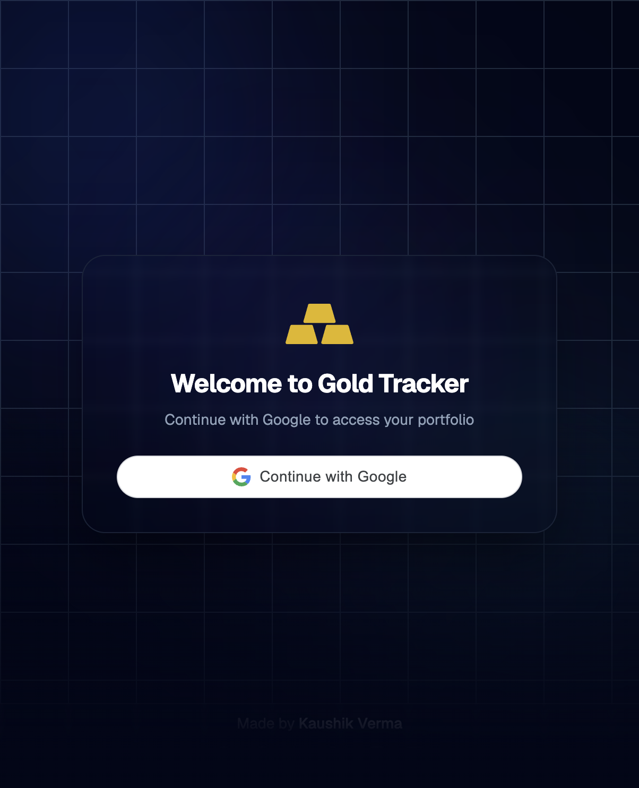
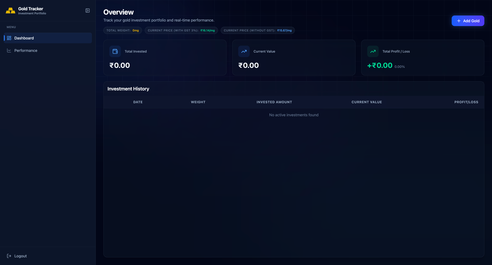
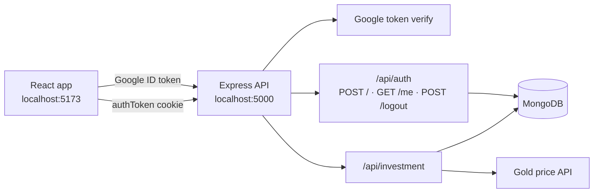

<center>
  <p align="center" style="text-align: center">
    
  </p>
  <h1 align="center" style="text-align: center">Gold Tracker</h1>
  <p align="center" style="text-align: center">
    A full-stack gold portfolio built with React, Vite, and Express — sign in with Google, record a purchase, and follow its value against the live INR price.
  </p>
  <p align="center" style="display: flex; align-items: center; justify-content: center; gap:10px;">
    
    
    
    
    
  </p>

  <h4 align="center" style="text-align: center">
    <a href="https://gold-tracker-kv.vercel.app/" target="_blank" rel="noopener noreferrer">🚀 Live Demo</a>
    <span> · </span>
    <a href="https://github.com/itskaushikverma/Gold-Tracker" target="_blank" rel="noopener noreferrer">📁 Repository</a>
  </h4>
</center>

## 📚 Table of Contents

- [About the Project](#about-the-project)
- [Screenshots](#screenshots)
- [Tech Stack](#tech-stack)
- [Features](#features)
- [Architecture](#architecture)
- [Getting Started](#getting-started)
- [Available Scripts](#available-scripts)
- [API](#api)
- [Project Structure](#project-structure)
- [Deployment](#deployment)
- [Contributing](#contributing)
- [Contact](#contact)

<a id="about-the-project"></a>

## ✨ About the Project

Gold Tracker is a small portfolio app with a React client and an Express API. After sign-in, the dashboard lists purchases and sales, and the performance charts follow each holding against the current gold price.

Auth and investment JSON responses use the same envelope:

```json
{ "success": true, "data": {}, "message": "Google authentication successful" }
```

Failed requests use `"success": false` and `"data": null`. `GET /api/health` is the exception and returns `{ "status": "ok", "timestamp": "..." }`.

<a id="screenshots"></a>

## 📸 Screenshots

<table>
  <tr>
    <td width="50%" align="center"></td>
    <td width="50%" align="center"></td>
  </tr>
</table>

<a id="tech-stack"></a>

## 🛠️ Tech Stack

- ⚛️ React 19
- ⚡ Vite 8
- 🎨 Tailwind CSS 4
- 🔄 Redux Toolkit Query
- 🧾 React Hook Form
- 📈 Recharts
- 🚂 Express 5
- 🍃 MongoDB + Mongoose
- 🔐 Google SSO + JWT
- 🧹 ESLint + Prettier

<a id="features"></a>

## 🌟 Features

- Continue with Google on a single `/auth` page (sign-in and sign-up are the same flow)
- Stay signed in across refreshes via an httpOnly JWT cookie and `GET /api/auth/me`
- Show the signed-in Google name, email, and avatar in the sidebar
- Record a purchase with a date, weight in milligrams, amount invested, and gold rate (Rs/mg)
- Mark one of your holdings as sold with a selling price and sell-time gold rate
- See invested amount, weight, purchase/sell gold rates, current value, and profit or loss on the dashboard
- Chart cumulative invested value against current value over time
- Save a custom selling price and chart that history, with an optional Gemini pass for the chart
- Keep investment routes limited to the signed-in user

<a id="architecture"></a>

## 🏗️ Architecture

The React app signs in with Google Identity Services, posts the ID token to `POST /api/auth`, and then sends the `authToken` cookie on later requests. On load it calls `GET /api/auth/me` to restore the session. Auth and investment routes both read and write MongoDB. Investment totals also use the live XAU/INR quote, converted to INR per milligram.



<a id="getting-started"></a>

## 🚀 Getting Started

### 📋 Prerequisites

- Node.js 20 or newer
- npm
- MongoDB

### 💻 Run Locally

Clone the project:

```bash
git clone https://github.com/itskaushikverma/Gold-Tracker.git
```

Move into the project folder:

```bash
cd Gold-Tracker
```

### 🔑 Google OAuth setup

1. Open [Google Cloud Console](https://console.cloud.google.com/apis/credentials) and create an OAuth 2.0 **Web** client ID.
2. Under **Authorized JavaScript origins**, add `http://localhost:5173` (and your production frontend origin when you deploy).
3. Copy the **Client ID** (ends with `.apps.googleusercontent.com`) into both `backend/.env` (`GOOGLE_CLIENT_ID`) and `frontend/.env` (`VITE_GOOGLE_CLIENT_ID`). Use the same value in both — do **not** put the Client Secret (`GOCSPX-…`) in either env file. This flow only verifies the Google ID token.

Install dependencies from the repository root:

```bash
npm run install:all
```

Copy the env examples and fill in values (see [Environment](#environment) below):

```bash
cp backend/.env.example backend/.env
cp frontend/.env.example frontend/.env
```

Start the frontend and API together from the repository root:

```bash
npm run dev
```

Open [http://localhost:5173](http://localhost:5173). The API listens on [http://localhost:5000](http://localhost:5000).

Set `VITE_API_URL` to `http://localhost:5000/api` so requests hit the `/api` mount. Fill in the Google Client ID in both env files before signing in. The app sends cookies with every request.

### 🔐 Environment

`backend/.env`

| Variable                          | Purpose                                                           |
| --------------------------------- | ----------------------------------------------------------------- |
| `PORT`                            | API port. Local default is `5000`.                                |
| `MONGO_URI`                       | MongoDB connection string.                                        |
| `JWT_SECRET`                      | Signing secret. Use at least 32 characters.                       |
| `FRONTEND_URL`                    | Allowed browser origin, for example `http://localhost:5173`.      |
| `GOOGLE_CLIENT_ID`                | Google OAuth Web Client ID (same as the frontend value).          |
| `GEMINI_API_KEY`                  | Optional. Required only for the AI selling-price chart.           |
| `GLOBAL_SELL_PRICE_OWNER_USER_ID` | MongoDB User `_id` whose sell prices power the Global Prices tab. |

`frontend/.env`

| Variable                | Purpose                                               |
| ----------------------- | ----------------------------------------------------- |
| `VITE_API_URL`          | API base URL, including `/api`.                       |
| `VITE_GOOGLE_CLIENT_ID` | Google OAuth Web Client ID from Google Cloud Console. |

<a id="available-scripts"></a>

## 📜 Available Scripts

From the repository root:

- `npm run install:all` — install root, frontend, and backend dependencies
- `npm run dev` — start the frontend and API together
- `npm run lint` — lint the web app and the API
- `npm run format` — format the repo with Prettier
- `npm run check` — run lint, then format

Useful package scripts:

- `frontend`: `npm run build`, `npm run preview`
- `backend`: `npm start` (API alone)

<a id="api"></a>

## 🔌 API

Investment routes require the `authToken` cookie from Google sign-in.

| Method | Path                                         | Auth |
| ------ | -------------------------------------------- | ---- |
| `POST` | `/api/auth`                                  | No   |
| `GET`  | `/api/auth/me`                               | Yes  |
| `POST` | `/api/auth/logout`                           | No   |
| `POST` | `/api/investment/purchase`                   | Yes  |
| `POST` | `/api/investment/sell`                       | Yes  |
| `POST` | `/api/investment/setCustomSellingPrice`      | Yes  |
| `GET`  | `/api/investment/getDetails`                 | Yes  |
| `GET`  | `/api/investment/getPerformance`             | Yes  |
| `GET`  | `/api/investment/getSellingPricePerformance` | Yes  |
| `GET`  | `/api/health`                                | No   |

`POST /api/auth` accepts `{ "credential": "<Google ID token>" }`, verifies it with Google, creates or finds the user, and sets the `authToken` cookie. The response includes `user_email`, `user_name`, and `user_avatar`.

`GET /api/auth/me` reads the cookie and returns the same profile fields so the frontend can restore the session after a refresh.

`POST /api/investment/purchase` accepts:

```json
{
  "date": "2026-11-07T12:00:00.000Z",
  "weight": 10.5,
  "investedValue": 5000,
  "goldRate": 476.19
}
```

That sets `goldRate.purchase` on the investment.

`POST /api/investment/sell` accepts:

```json
{
  "investment_id": "<MongoDB ObjectId>",
  "sellingPrice": 5500,
  "goldRate": 520.5
}
```

That marks the holding sold (`isSell.status`, `isSell.amount`) and sets `goldRate.sell`.

Each investment stores gold rates as:

```json
{ "goldRate": { "purchase": 476.19, "sell": 0 } }
```

`sell` stays `0` until the holding is sold. The dashboard shows them as `sell / purchase` (for example `-- / ₹476.19` before sale).

`getDetails` and `getPerformance` require a boolean `sellPriceOverride` query param. When `true`, calculations use the latest saved custom selling price instead of the live gold quote. Saving a custom price is the separate POST.

`getSellingPricePerformance` requires a `scope` query param: `my` (signed-in user), `smart` (AI-formatted chart for the signed-in user), or `global` (owner user from `GLOBAL_SELL_PRICE_OWNER_USER_ID`).

<a id="project-structure"></a>

## 🧩 Project Structure

```text
.
├── backend/
│   ├── config/
│   ├── controllers/auth/          # google, me, logout
│   ├── controllers/investment/
│   ├── middleware/protect.js
│   ├── models/                    # user, investment, customSellingPrice
│   ├── routes/
│   ├── services/
│   ├── utils/
│   └── index.js
├── frontend/
│   └── src/
│       ├── components/
│       │   ├── auth/GoogleAuthButton.jsx
│       │   ├── common/
│       │   ├── dashboard/DashboardCard.jsx
│       │   ├── layout/               # AuthBootstrap, Sidebar, …
│       │   ├── modals/               # AddEntry, SellEntry, SetCustomSellingPrice
│       │   └── ui/Switch.jsx
│       ├── constants/apiEndpoints.js
│       ├── pages/                    # Auth, Dashboard, Performance, …
│       ├── redux/
│       ├── services/api.js
│       ├── App.jsx
│       └── main.jsx
└── docs/screenshots/                 # auth.png, dashboard.png
```

<a id="deployment"></a>

## 🌐 Deployment

Build the web app:

```bash
cd frontend
npm run build
npm run preview
```

Run the API with the production environment variables set in `backend/.env`, including `GOOGLE_CLIENT_ID`, `JWT_SECRET`, `MONGO_URI`, and `FRONTEND_URL`. On the frontend host, set `VITE_API_URL` and `VITE_GOOGLE_CLIENT_ID`, and add the production origin to the Google OAuth client's Authorized JavaScript origins.

```bash
cd backend
npm start
```

<a id="contributing"></a>

## 🤝 Contributing

Contributions, issues, and feature suggestions are welcome.

If you would like to contribute:

- fork the repository
- create a feature branch
- commit your changes
- open a pull request

<!-- AUTHOR:START -->
<h2 id="contact" style="margin: 12px 0 8px">👤 Author</h2>
<div align="center" style="margin: 0">
  
  <h3 style="margin: 8px 0 4px">Kaushik Verma</h3>
  <p style="margin: 0 0 8px">
    <a href="mailto:kaushikverma321@gmail.com"></a>
    <a href="https://kaushikverma.vercel.app"></a>
    <a href="https://github.com/itskaushikverma"></a>
    <a href="https://www.linkedin.com/in/itskaushikverma"></a>
    <a href="https://x.com/SilentK68296830"></a>
  </p>
  <p style="margin: 0">Open to product feedback, collaboration, and thoughtful conversation.</p>
</div>
<div align="center" style="margin: 8px 0 0">
  <p style="margin: 0 0 4px">If you found this project helpful, please consider giving it a ⭐️</p>
  <a href="https://github.com/itskaushikverma/template"></a>
</div>
<!-- AUTHOR:END -->
