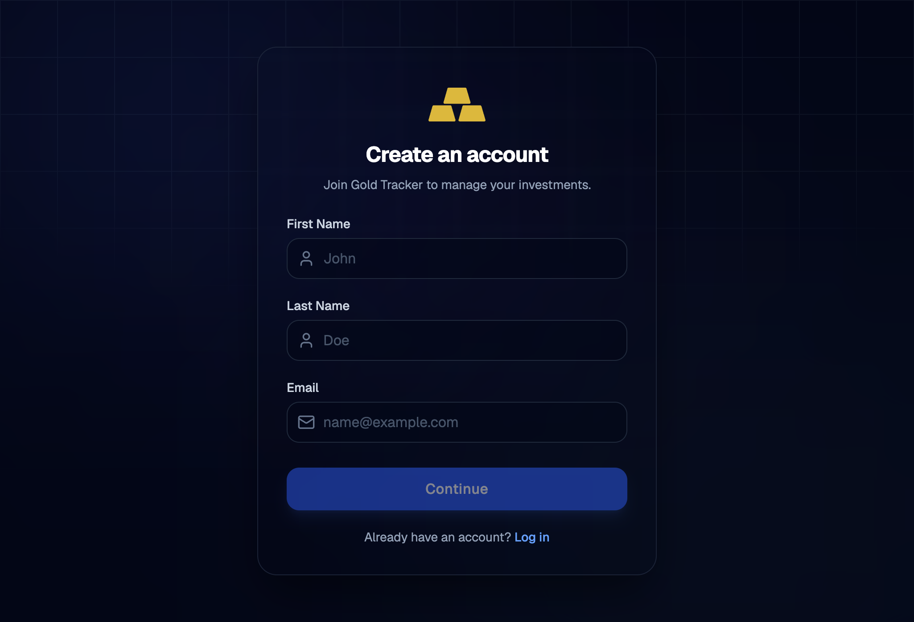
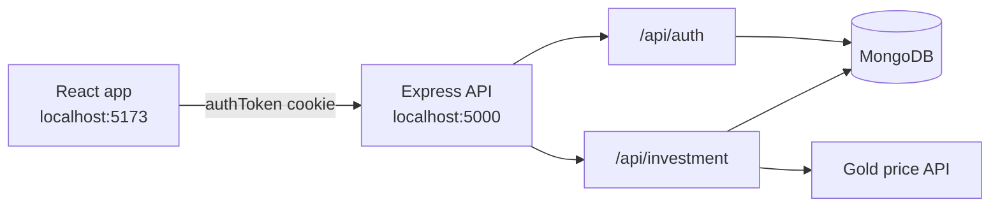

<p align="center">
  
</p>

<h1 align="center">Gold Tracker</h1>

<p align="center">
  Sign in, record a gold purchase, and follow its value against the live INR price.
</p>

<p align="center">
  &nbsp;&nbsp;&nbsp;&nbsp;
  &nbsp;&nbsp;&nbsp;&nbsp;
  &nbsp;&nbsp;&nbsp;&nbsp;
  &nbsp;&nbsp;&nbsp;&nbsp;
  
</p>

---

## Preview



After sign-in, the dashboard lists purchases and sales, and the performance charts follow the holding against the current gold price.

## Features

- **Accounts** — Check the email, set a password, sign in, and stay signed in with an httpOnly JWT cookie.
- **Purchases** — Record a date, weight in milligrams, and the amount invested.
- **Sales** — Mark one of your holdings as sold at a selling price.
- **Dashboard** — Invested amount, weight, current value, and profit or loss.
- **Performance** — Cumulative invested value versus current value over time.
- **Custom price** — Save a selling price and chart that history. An optional Gemini pass formats the chart.
- **Owned data** — Investment routes use the signed-in user. A client cannot pass another user's id.

## Tech stack

| Layer   | Tools                                                                                         |
| ------- | --------------------------------------------------------------------------------------------- |
| Web app | React 19, Vite, Redux Toolkit Query, React Router, Tailwind CSS, Recharts, react-toast-kit-js |
| API     | Node.js, Express 5, Mongoose, JWT, bcrypt                                                     |
| Data    | MongoDB                                                                                       |
| Price   | Live XAU/INR quote, converted to INR per milligram                                            |

## Architecture



Every JSON response uses the same envelope:

```json
{ "success": true, "data": {}, "message": "Login successful" }
```

Failed requests use `"success": false` and `"data": null`.

## Getting started

Use **Node.js 20+** and a MongoDB database.

### 1. Clone

```bash
git clone https://github.com/itskaushikverma/Gold-Tracker.git
cd Gold-Tracker
```

### 2. API

```bash
cd backend
cp .env.example .env
npm install
npm start
```

The API listens on [http://localhost:5000](http://localhost:5000).

### 3. Web app

In a second terminal:

```bash
cd frontend
cp .env.example .env
npm install
npm run dev
```

Open [http://localhost:5173](http://localhost:5173).

Set `VITE_API_URL` to `http://localhost:5000/api` so requests hit the `/api` mount. The app sends cookies with every request.

## Environment

### `backend/.env`

| Variable         | Purpose                                                      |
| ---------------- | ------------------------------------------------------------ |
| `PORT`           | API port. Local default is `5000`.                           |
| `MONGO_URI`      | MongoDB connection string.                                   |
| `JWT_SECRET`     | Signing secret. Use at least 32 characters.                  |
| `FRONTEND_URL`   | Allowed browser origin, for example `http://localhost:5173`. |
| `GEMINI_API_KEY` | Optional. Required only for the AI selling-price chart.      |

### `frontend/.env`

| Variable       | Purpose                         |
| -------------- | ------------------------------- |
| `VITE_API_URL` | API base URL, including `/api`. |

## API

Investment routes require the `authToken` cookie from login or register.

| Method | Path                                           | Auth |
| ------ | ---------------------------------------------- | ---- |
| `POST` | `/api/auth/check-email`                        | No   |
| `POST` | `/api/auth/register`                           | No   |
| `POST` | `/api/auth/login`                              | No   |
| `POST` | `/api/auth/logout`                             | Yes  |
| `POST` | `/api/investment/purchase`                     | Yes  |
| `POST` | `/api/investment/sell`                         | Yes  |
| `POST` | `/api/investment/setCustomSellingPrice`        | Yes  |
| `GET`  | `/api/investment/getdetails`                   | Yes  |
| `GET`  | `/api/investment/getPerformance`               | Yes  |
| `GET`  | `/api/investment/getSellingPricePerformance`   | Yes  |
| `GET`  | `/api/investment/getSellingPricePerformanceAi` | Yes  |
| `GET`  | `/api/health`                                  | No   |

`getdetails` and `getPerformance` accept an optional `customGoldSellingPrice` query value. That value is used for the calculation only. Saving a custom price is the separate POST.

## Project structure

```text
.
├── backend/          Express API
│   ├── controllers/
│   ├── middleware/
│   ├── model/
│   ├── routes/
│   ├── services/
│   └── utils/
└── frontend/         React app
    └── src/
        ├── components/
        ├── pages/
        ├── redux/
        └── services/
```

---

<!-- AUTHOR:START -->
## 👨‍💻 Author

**Kaushik Verma**

<p align="left">
  <a href="https://www.kaushikverma.com" target="_blank" rel="noopener noreferrer"></a>&nbsp;&nbsp;
  <a href="https://github.com/itskaushikverma" target="_blank" rel="noopener noreferrer"></a>&nbsp;&nbsp;
  <a href="https://www.linkedin.com/in/itskaushikverma" target="_blank" rel="noopener noreferrer"></a>&nbsp;&nbsp;
  <a href="https://x.com/SilentK68296830" target="_blank" rel="noopener noreferrer"></a>&nbsp;&nbsp;
  <a href="https://www.instagram.com/itskaushikverma" target="_blank" rel="noopener noreferrer"></a>&nbsp;&nbsp;
  <a href="mailto:kaushikverma321@gmail.com" target="_blank" rel="noopener noreferrer"></a>
</p>
<!-- AUTHOR:END -->
